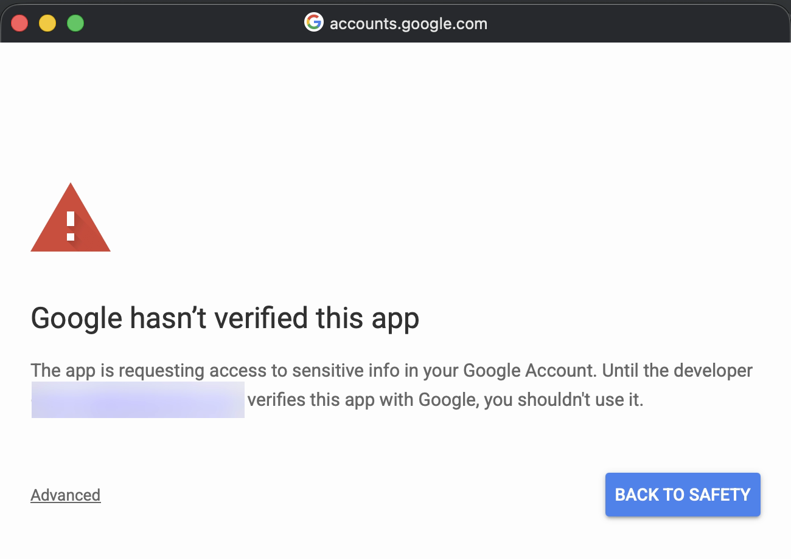
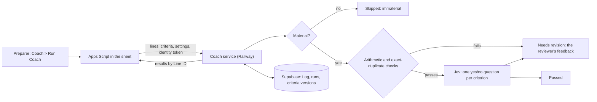

# Working Note

A coach for financial variance commentary. The site, with the film and a bench to try: [working-note.lovable.app](https://working-note.lovable.app).

Working Note is a Google Sheet and a small Python service that check whether flux commentary can be reviewed against a team's own written standard, before it reaches the reviewer. In the sheet it is the **Coach** menu, and this README calls it the Coach for short.

Most finance AI starts by drafting the work. That removes the loop where judgment develops: write the explanation, get it marked up, revise. The Coach keeps that loop. The controller writes the standard down once and tunes it as the team and the business change. The preparer writes the commentary, gets that controller's feedback immediately, revises, and hands over cleaner work. Preparers get the markup earlier; reviewers repeat themselves less.

**The boundary.** The Coach checks whether commentary is reviewable against the team's stated standard.

- It never writes the explanation.
- It never invents feedback. When a line fails, the preparer reads the reviewer's own words from the Criteria tab, verbatim.
- It never decides whether the business explanation is true. That stays with the reviewer, and the preparer still talks to the business owner.

It is a coaching tool, not a control. There is no sign-off, nothing it records is meant as control evidence, and it never replaces the review.

## Contents

- [Before you set it up](#before-you-set-it-up): the Google warning, what the script can access, what leaves the sheet
- [How it works](#how-it-works)
- [Criteria and calibration](#criteria-and-calibration)
- [Try it locally](#try-it-locally)
- [Setting it up for a team](#setting-it-up-for-a-team)
- [Onboarding a team](#onboarding-a-team)
- [Verification](#verification)
- [Known friction](#known-friction)
- [Out of scope, and what's next](#out-of-scope-and-whats-next)
- [Repository map](#repository-map)

## Before you set it up

What each person on the team will see, and where their data goes.

### Google's "unverified app" warning

The first time each person uses the Coach menu, Google asks them to authorize the script and shows a screen headed **"Google hasn't verified this app."** Nothing is broken. The script is open source and bound to your team's own copy of the sheet, and it hasn't been submitted to Google's verification process, which exists for apps published to the public. To continue, choose **Advanced**, then **Go to Working Note (unsafe)**, review the permissions, and choose **Allow**. Each person does this once.



The name on these screens is the Apps Script project's name, so name the project before anyone authorizes it (setup step 1); otherwise Google shows "Untitled project". On Google Workspace, a script owned by an account in the same domain as everyone who uses it is internal to that domain, and Google doesn't show this screen at all. A script owned by a personal Gmail account always shows it.

### What the script can access

The manifest (`apps_script/appsscript.json`) asks for five scopes and nothing else:

| Scope | What it lets the script do |
| --- | --- |
| `spreadsheets.currentonly` | Read and write this spreadsheet only. No other file in Drive. |
| `script.external_request` | Call the Coach service. `urlFetchWhitelist` limits calls to your service's address. |
| `script.container.ui` | Show the Coach menu, dialogs and messages in this sheet. |
| `userinfo.email`, `openid` | Get a Google identity token with your email, which the service verifies to look up your role. |

### What leaves the sheet, and where it goes

**To your Coach service** (your Railway deployment), on Run Coach: each Flux row's Line ID, entity, period, comparison basis, account, prior, current, variance ($ and %), commentary and row number; the Criteria and Settings tabs, with the email of whoever last edited a criterion when Google shares it; the spreadsheet's ID; and the identity token. Submit overrides sends the Override values and notes. Run criteria health sends the Criteria and Settings tabs and any Resolutions.

**To Jev, for grading.** Jev is TypeSafe's yes/no decision model, reached through OpenRouter or TypeSafe directly. Only lines that are material and passed the arithmetic and duplicate checks are sent, and for each one only:

- the row: account, comparison basis, prior, current, and the change in $ and %;
- the commentary;
- for each active criterion Jev grades, its "Passes when" text and a fixed instruction.

Never sent: entity, period, Line ID, anyone's email, or a criterion's name, feedback, rationale or example. Through OpenRouter every request sets `data_collection: "deny"` (the default; `JEV_DATA_COLLECTION` changes it), so OpenRouter routes it only to providers it lists as not collecting prompts, and `allow_fallbacks: false`, so it is never silently routed to a backup provider. A deployment that calls TypeSafe directly skips OpenRouter, and TypeSafe's own policy applies. The run's random ID goes along as the session ID. Field by field: [docs/question-builder.md](docs/question-builder.md).

**Your Google account email.** The service reads it from the verified identity token to look up your role in the team list, and to record who did what: who started a run, who submitted an override, who edited a criterion. If Google doesn't share an email (it can withhold it, most often outside a shared Google Workspace domain), you are treated as a preparer and your overrides save without attribution.

**Stored in your team's own Supabase database**, not anywhere the author of this repo can see:

- lines (figures as last seen) and every version of their commentary;
- runs: who started each one, the settings and criteria version it used;
- the Log: one insert-only row per line, criterion and attempt, with the result, the Jev probability and the versions behind it;
- overrides and their notes, criteria snapshots and Criteria History, calibrations, Criteria Health prompts and resolutions;
- the team list (emails and roles) and sheet keys (SHA-256 hashes only);
- a cache of Jev answers, keyed by a fingerprint of the question: probabilities, no text.

Row-level security is on for every table, and Supabase's public API roles (`anon`, `authenticated`) have no access to any of them. The Log and the other history tables are insert-only: a trigger refuses UPDATE, DELETE and TRUNCATE for every role, the owner included.

**During onboarding**, past commentary goes to whichever AI assistant the team uses for the interview, and the labeled sample goes to Jev once, for calibration, with the same fields as above.

**This repository** holds no company's real data. The tests run on Fernhill Data, a fictional company, and none of it is deployed.

## How it works



One click, three outcomes. Immaterial lines never reach Jev. A line that fails on something objective gets feedback before any model call. Everything else gets one Jev question per criterion. The preparer revises and reruns until the line passes or they take it to their reviewer.

### Who checks what

Checks run in tiers, and the middle tier is never presented as fact.

| Check | Tier | Fails when |
| --- | --- | --- |
| Materiality gate | Deterministic | The variance is under both the $ and % thresholds in Settings, so the line is skipped entirely. Equal counts as material; with a zero prior, the $ test decides alone. |
| Arithmetic (ARITH) | Deterministic, after parsing | The amounts cited for the drivers don't sum to the variance within tolerance. It abstains when amounts can't be parsed cleanly (ranges, percentages, offsets) rather than guessing. |
| Exact duplicate (DUP) | Deterministic | Identical text appears on another line in the same close. |
| Near-duplicate (NEAR) | Heuristic | Similarity to another line is at or above the threshold in Settings. Flagged as likely, not certain. |
| Restatement (RESTATE) | Jev | The commentary likely just repeats the figures already in the row. |
| Reviewer criteria (C1 to C5 by default) | Jev | Jev's probability that the commentary meets the criterion is below that criterion's own threshold. |

Deterministic checks run first, so Jev never grades a line that already failed arithmetic or is an exact copy. A heuristic near-duplicate flag doesn't stop grading.

**What the preparer sees.** Status (Passed, Needs revision, Skipped: immaterial, Needs commentary, Passed, reviewer prompt, or Not graded), the failed criteria, and Feedback. Lines that need work are shaded light red, and from the second attempt on the Status says which attempt it is, as in *Passed (attempt 2)*. Feedback is only the text in the Criteria tab's "Feedback when failed" column, verbatim, labeled with the criterion ID. Jev and near-duplicate flags carry "(likely)" in Failed criteria; deterministic ones don't. Probabilities and arithmetic detail sit in the Status cell's note, where a curious preparer can look and nobody mistakes them for feedback.

**Calibrated or not.** A Jev flag on a calibrated criterion fails the line. A flag on an uncalibrated criterion is not shown to the preparer as a failure: it becomes a prompt for the reviewer, because nobody has checked that this criterion, worded this way, at this threshold, on this model, grades the way the team does. Nothing ships calibrated: every Jev-graded criterion starts Uncalibrated, so until your team calibrates on its own labeled lines ([setup step 7](#7-your-standard-calibrated)), preparers see the deterministic checks and Jev's flags go to the reviewer.

**Line IDs and attempts.** Each line has a persistent ID built from entity, close period, comparison basis, account and any slice (`FHD-US|2026-09|MoM|5000`). Results are written back by Line ID, never by row number. A second attempt counts only when the same Line ID comes back with changed commentary (a different SHA-256 of the normalized text) after failing. A rerun with unchanged text doesn't count, and a new close is a new Line ID.

**Two people at once.** A run takes the sheet's document lock in Apps Script and a lease on the service, so only one run writes at a time. A line whose commentary changed while the run was out is skipped and marked for a re-run instead of getting stale feedback.

**Model pinning.** The Settings tab's "Pinned model version" must match the service's pin (`jev-1.13.0`). The service requests the dated snapshot `typesafe/jev-1.13-20260917`, refuses to start if configured with an alias such as `~typesafe/jev-latest`, and grades only answers served by a snapshot its calibrations were measured on.

### Roles

The service verifies each request's identity and looks the person up in the team list, so roles are enforced on the server, not just hidden in the menu.

| Tab | Preparer | Reviewer |
| --- | --- | --- |
| Flux | Edits commentary, runs Coach, can set an override | Reads, runs Coach, sets overrides |
| Criteria and Settings | Reads | Edits (protected range) |
| Log, Criteria History, Criteria Health, Second Attempts | Hidden; editing shows a warning | Hidden; editing shows a warning |

The Log, runs and criteria snapshots live in Supabase. The sheet's Log tab is a read-only copy the service writes back, so a preparer's script never needs write access to protected tabs.

### Keeping criteria current

At the end of a close the reviewer picks **Coach > Run criteria health**. The Criteria Health tab lists only the criteria that need a look, each with a Resolution dropdown: edit, retire or keep. These are prompts, not diagnoses.

| Signal | What it suggests | Source |
| --- | --- | --- |
| Almost never fails | The team has learned it (retire it), or it's too loose | Log |
| Almost always fails | Too strict, unclear, or not being taught | Log |
| Probabilities cluster near the threshold | The criterion is vague; rewrite it as a sharper condition | Log |
| Reviewer marks a flag as wrong | Miscalibrated for this team | Overrides |
| Reviewer still marks up a line that passed | A standard exists that no criterion covers ("not covered") | Overrides |
| Not reviewed in two closes | Nobody is maintaining it | Last reviewed |

No prompt fires until a criterion has the minimum number of material lines behind it. Reviewer overrides count double. Every edit to a criterion lands in Criteria History with who, when and a diff, and every Log row carries the criterion version, so anyone can see why feedback on a line changed between months. Editing a criterion's pass condition or threshold makes it uncalibrated; editing its feedback, name, rationale or example doesn't. Re-confirming ("keep") means the reviewer still agrees with the wording, not that the model was re-validated.

The same run rebuilds the **Second Attempts** tab: second attempts per criterion, per close. It measures the learning signal without a per-person scorecard.

## Criteria and calibration

Five starter criteria ship in the Criteria tab, plus RESTATE and the three rules in code. Each checks what the commentary says, not whether it is true. C5, for example, makes sure there are amounts for the arithmetic check to test; it doesn't check that they're right. None of them can confirm that a driver actually happened.

| ID | Criterion | Passes when | Starting threshold |
| --- | --- | --- | --- |
| C1 | Names a specific driver | Names the specific cause of the change, identified well enough that a reviewer could look it up: which customer, vendor, contract, hire or event, and what changed with it. Fails when the cause is a category ("timing", "growth", "higher volume"), even with an amount or dates attached, or when the only name given is where the cost was booked or who billed it. | 0.43 |
| C2 | Explains why, not just what | Says what changed in the business, not only which account moved | 0.84 |
| C3 | Separates one-time from recurring | States whether the driver repeats next period | 0.15 |
| C4 | Points to evidence | References something a reviewer could pull: invoice, JE, contract, headcount report | 0.74 |
| C5 | Sizes each driver | Gives an amount or share for each driver named, or says what is still unexplained | 0.36 |
| RESTATE | Says more than the row | Adds something beyond the figures already in the row | 0.85 |
| ARITH, DUP, NEAR | Rules in code | Amounts add up; not copied; not a template | n/a |

**Nothing ships calibrated.** Every Jev-graded criterion starts Uncalibrated, the five above included. Their starting thresholds came from calibrating on Fernhill Data, the fictional company the tests use, so they say how Jev grades a made-up team's commentary, not yours. They are a place to begin. Until your reviewer labels a sample of past lines and `calibrate.py` measures each criterion on it ([setup step 7](#7-your-standard-calibrated)), the starter criteria still run, and their flags reach the reviewer as prompts instead of failing a preparer's line.

**C1 was tightened after a blind check.** The original wording ("Points to a vendor, contract, hire, customer, or event, not a category") let any detail stand in for a driver: adding "($48.5K, Sep 9 to Sep 24)" or "on our Stratus Compute account" to a vague line lifted it over the threshold. The reworded condition was scored on 36 new texts, written and labeled before scoring under rules fixed in advance. Balanced accuracy went from 0.78 to 0.97 and AUC from 0.92 to 0.997; it kept all 18 good texts and caught 17 of 18 vague ones. The one it missed names only the vendor that billed the account, plus an amount. The rules, texts, labels, recordings and results are in [docs/evidence/c1-blind-check](docs/evidence/c1-blind-check/README.md). C2 to C5 keep their original wording.

**How calibration sets a threshold.** Each criterion is calibrated on its own, because six different questions don't behave alike under one global threshold. Every labeled line is marked pass or fail on every criterion. A seeded, stratified 25% is held out; the threshold that maximizes balanced accuracy on the other 75% is chosen and then checked on the held-out slice. A criterion is Calibrated only if held-out balanced accuracy is at least 0.75 with at least two passes and two fails held out, which is why it needs six or more labeled lines of each.

A verdict depends on four things together: the model snapshot, the pass condition, the question builder's version and the threshold. Those four form the calibration's fingerprint, and the service looks it up on every run; the Calibration status in the sheet is a display of that lookup. Editing a pass condition or a threshold makes a criterion Uncalibrated until it is measured again.

**What to expect from Jev.** Why this design uses Jev for judgment and code for everything code can check, with the sources, their figures and their limits: [docs/why-jev.md](docs/why-jev.md).

- **Jev reads literally.** Asked about C1, an early version of the question builder let "a large customer" pass because the word customer is in the condition. The stricter instruction in the current builder (qb-1.1.0) fixed most of that, and C1's tightened wording fixed the rest of what the labels showed. C5 still fails a single driver sized only by the total. When your reviewer disagrees with a flag, an Override of "Flag was wrong" records it, and Criteria Health raises a criterion that collects them. Details and the A/B evidence: [docs/question-builder.md](docs/question-builder.md).
- **Thresholds aren't comparable across criteria.** C3's 0.15 and C1's 0.43 reflect how Jev's probabilities spread for each question, which is why each criterion has its own.
- **The tests replay real Jev answers.** Every probability in the test suite is a real answer from the pinned snapshot (672 recorded questions about Fernhill's lines), replayed strictly: a question with no recording fails loudly instead of being made up.

## Try it locally

Needs Python 3.11 (the service itself runs on 3.9 or later), Node 22 for the Apps Script tests, and, for the database tests, Postgres 17 (`brew install postgresql@17`). No accounts or keys.

```bash
make venv
```

```bash
make test
```

`make test` runs everything that needs no database, on Fernhill Data and Jev answers recorded once and replayed.

With Postgres installed, `make db-up` starts a throwaway local cluster in `.pgdata/` (localhost only), and `make verify` runs every gate (see [Verification](#verification)). If `make` can't find Python 3.11 or Postgres 17, point it at them: `make venv PYTHON=/path/to/python3.11`, or `make verify PG_BIN=/path/to/postgres/bin`.

## Setting it up for a team

One technical person does this once. Everyone else opens the sheet in their browser and installs nothing.

You'll need accounts at Supabase, Railway, and OpenRouter (or TypeSafe), and a Google account, ideally in the same Google Workspace as the team. Each team deploys its own service and database with its own Jev key, so its commentary never touches anyone else's infrastructure. Sign in to each service yourself; nothing here asks you to paste a password into a script.

Start from the repo root with `make venv` done.

### 1. Supabase: the database

1. Create a project. Under **Connect**, copy the **Transaction pooler** connection string (port 6543).
2. Open `backend/.env` (copy `backend/env.example` first, then `open -e backend/.env`) and set `DATABASE_URL` to that string, with `[YOUR-PASSWORD]` replaced by the real password, brackets included. Keep it in the file: database passwords often contain `$` or `!`, which a shell expands if you paste the string into a command. A password with `%`, `@`, `/`, `?`, `#`, `[` or `]` has to be percent-encoded in the string; paste it raw and let the checker do it, once:

```bash
.venv/bin/python scripts/check_dsn.py --encode-password --connect
```

   Without `--encode-password` it only reports problems. It never prints the string, and neither does anything else here: every connection goes through `coach/dsn.py`, which refuses a malformed string in its own words, because the database driver's own parse errors quote the password.
3. Apply the schema and the defaults, then check what Postgres actually enforces:

```bash
.venv/bin/python scripts/apply_migrations.py --seed
```

```bash
.venv/bin/python scripts/verify_db.py
```

`verify_db.py` checks row-level security, privileges, the insert-only triggers and views, then probes that UPDATE, DELETE and TRUNCATE on the Log are refused. It ends with `RAN: verify_db` and a check count, and lists any `FAIL`.

The seed adds the starter Criteria and Settings and nothing else: no people (step 5 adds them) and no calibrations (step 7).

4. Optional, and recommended: give the service a login that can't rewrite history. The migrations create a `coach_service` role that can add to the Log and the other history tables but can't change, delete or unguard them. This creates a login in that role, with a random password Postgres only ever sees as a SCRAM hash (so it's in no SQL statement, log or editor history), and writes its connection string to `backend/.env` as `COACH_SERVICE_DATABASE_URL`:

   ```bash
   .venv/bin/python scripts/create_service_login.py
   ```

   Then run `verify_db.py` again: with that variable set, it also proves, as the service's own login, that it can add a Log row but can't update, delete, truncate or unguard the Log, isn't a superuser, can't bypass row-level security and owns no table. Railway's `DATABASE_URL` takes the `COACH_SERVICE_DATABASE_URL` value; the owner's string stays in `backend/.env` for the admin scripts. The production-shape test runs the service exactly this way.

### 2. Jev: the model key

1. Create an API key at OpenRouter. Put it in `backend/.env` as `OPENROUTER_API_KEY` for local recording and calibration; the service gets it as a Railway variable in step 3.
2. Check it with one real call on a sample line (a fraction of a cent), which prints the snapshot that answered:

```bash
.venv/bin/python scripts/record_jev.py --probe
```

To use TypeSafe directly instead, set `JEV_PROVIDER=typesafe` and `TYPESAFE_API_KEY`. If OpenRouter ever reports no eligible provider with `data_collection: "deny"`, the right response is a decision about where the commentary may go, not quietly switching to `allow`.

### 3. Railway: the service

```bash
brew install railway
```

```bash
railway login
```

```bash
railway init --name working-note
```

```bash
railway add --service coach
```

That creates the project and an empty service. Set the variables below before the first deploy; the service refuses to start on an incomplete or unsafe configuration and says why in the deploy log. Then deploy, streaming the build log:

```bash
railway up --service coach --ci
```

`backend/Dockerfile` installs only the hash-locked dependencies in `backend/requirements.lock`, runs as a non-root user, and copies just the service code. `.railwayignore` and `.gitignore` keep `backend/.env` out of the upload, and `.dockerignore` admits only those two paths to the image. Railway no longer reads `railway.json` for new services, and its newer configuration file doesn't cover Dockerfile builds, so the Dockerfile path is a service variable (`RAILWAY_DOCKERFILE_PATH`, below) and the health check is a setting: **Settings > Deploy > Healthcheck Path** `/healthz`. That route returns 503 when the database can't be reached, so a deploy that can't reach it never goes live. Pick the region nearest your database under **Settings > Deploy > Regions**.

Set these under the service's **Variables** in the dashboard. The secrets (`DATABASE_URL`, `OPENROUTER_API_KEY`) belong there; the rest can also be set from the terminal with `railway variable set --service coach --skip-deploys KEY=value`.

| Variable | Value |
| --- | --- |
| `RAILWAY_DOCKERFILE_PATH` | `backend/Dockerfile` |
| `COACH_ENV` | `production` |
| `COACH_STORE` | `postgres` |
| `DATABASE_URL` | the transaction pooler string from step 1: `COACH_SERVICE_DATABASE_URL` if you created the service login |
| `JEV_MODE` | `live` |
| `JEV_PROVIDER` | `openrouter` |
| `OPENROUTER_API_KEY` | the key from step 2 |
| `JEV_ALLOWED_SNAPSHOTS` | `typesafe/jev-1.13-20260917` |
| `COACH_AUTH_MODES` | `sheet_key` for now; step 4 turns on Google sign-in |

Then generate a public address with `railway domain --service coach` (or **Settings > Networking > Generate Domain**), and check `https://<your-domain>/healthz`. The unsafe combinations it refuses include a memory store, an alias model, live Jev without allowed snapshots, and Google sign-in without an audience. Every other setting has a sensible default; `backend/env.example` lists them all.

### 4. The Google Sheet and its script

1. Create a Google Sheet. Open **Extensions > Apps Script**, click **Untitled project** at the top and rename it **Working Note** (Google shows this name when people authorize the script), then open **Project Settings** and copy the **Script ID**.
2. Turn on the Apps Script API at https://script.google.com/home/usersettings, and sign clasp in with the same Google account:

```bash
npx @google/clasp@3.4.1 login
```

3. Push the script. The repo's `apps_script/.clasp.json` and `appsscript.json` are templates; this stages a copy with your Script ID, and your service's address as the only one the script may call, and pushes that:

```bash
.venv/bin/python scripts/push_apps_script.py --script-id <Script ID> --service-url https://<your-domain>
```

4. Reload the sheet. A **Coach** menu appears. Choose **Coach > Admin > Configure service** and enter the service address (`https://...`, no trailing slash). Leave the sheet key blank.
5. **Coach > Admin > Show connection info** shows the identity token's audience. On Railway, set `GOOGLE_AUDIENCES` to that value and `COACH_AUTH_MODES` to `google,sheet_key`, and let it redeploy. The service rejects identity tokens issued for any other audience; `GOOGLE_HOSTED_DOMAINS` can also restrict them to your Workspace domain.
6. Add yourself as a reviewer (step 5), then **Coach > Admin > Refresh my role** and **Coach > Admin > Set up sheet**. Setup builds every tab, loads the default Criteria and Settings from the service, locks Criteria and Settings to reviewers (the lock icon on those tabs: reviewers edit them, preparers can only read them), and hides the tabs the service writes. It's safe to run again.

### 5. The team

```bash
.venv/bin/python scripts/team.py add you@yourco.com --role reviewer --name "Your Name"
```

Add each preparer the same way with `--role preparer`, and check with `scripts/team.py list`; `scripts/team.py deactivate <email>` takes someone off. A verified email that isn't on the list is refused unless `COACH_ALLOW_UNLISTED=yes`. Role changes apply on the person's next action; their menu catches up with **Coach > Admin > Refresh my role**.

### 6. Your close in the Flux tab

**Set up sheet** built the Flux tab with its headers. Paste or import each close under them, one row per line: Entity, Period (the close month, such as 2026-09), Comparison basis (such as MoM), Account, Prior, Current, Variance ($), Variance (%) and Commentary. Leave Line ID blank: the first **Run Coach** builds one for each row from its entity, period, basis and account, and from then on results attach to the Line ID, so sorting the rows is safe. Variance ($) and Variance (%) can be blank too; the service works them out from Prior and Current. Status, Failed criteria and Feedback are the Coach's columns; Override and Override note are for whoever disagrees with a result.

### 7. Your standard, calibrated

Until this step nothing is calibrated: preparers get the materiality, arithmetic and duplicate checks, and Jev's flags go to the reviewer as prompts. To make Jev's flags a preparer's feedback, the reviewer writes the team's standard down and labels a sample of past lines ([Onboarding a team](#onboarding-a-team)). Then, from the repo root with the onboarding files in `onboarding/`, record Jev's answers for the sample, calibrate, and write the thresholds into the tabs. Recording sends each labeled line's account, comparison basis, amounts and commentary to Jev and costs a fraction of a cent; run it with `--dry-run` first to see exactly what would be sent.

```bash
.venv/bin/python scripts/record_jev.py --labels onboarding/labels.csv --criteria onboarding/criteria.csv --recordings onboarding/team_recordings.jsonl --yes
```

```bash
.venv/bin/python scripts/calibrate.py --labels onboarding/labels.csv --criteria onboarding/criteria.csv --recordings onboarding/team_recordings.jsonl --out onboarding/team_calibration.json --write-db
```

```bash
.venv/bin/python supporting/skills/working-note-onboarding/scripts/write_tabs.py package.json --out onboarding --calibration onboarding/team_calibration.json
```

`--write-db` records the results where the service looks them up. The last command writes each threshold into `criteria.csv`, because the fingerprint includes the threshold: a sheet whose threshold differs from the calibrated one is, correctly, uncalibrated. Then, in the sheet, open the Criteria tab and use **File > Import > Upload** with "Replace current sheet" for `criteria.csv`; do the same on the Settings tab with `settings.csv`; run **Coach > Admin > Set up sheet** to restore the dropdowns and protections; and run **Coach > Sync criteria status**.

A criterion needs at least six fail labels and six pass labels to be calibrated (a quarter of each is held out, and two of each must be). One that stays Uncalibrated still runs; its flags go to the reviewer as prompts instead of to the preparer. Calibrate again after rewording a pass condition or changing a threshold.

### Sheet keys: the fallback

When identity tokens can't be used (for example, people outside a shared Workspace domain whose email Google won't share), a sheet key stands in. Keys are scoped to one spreadsheet, capped at a role, rate-limited and revocable, and only their SHA-256 is stored.

```bash
.venv/bin/python scripts/sheet_keys.py issue --sheet <spreadsheet id> --role preparer
```

The key is printed once. Enter it in **Coach > Admin > Configure service**. A key can't say who is using it, so overrides made with one are stored as unverified. `scripts/sheet_keys.py list` shows keys and `revoke <key id>` turns one off immediately.

## Onboarding a team

A team sets its criteria through an interview, never by filling in the Criteria tab from scratch. It ships two ways:

- [supporting/onboarding_prompt.md](supporting/onboarding_prompt.md): paste it into any chat assistant.
- [supporting/skills/working-note-onboarding](supporting/skills/working-note-onboarding/SKILL.md): a Claude Skill that also reads the folder of past files and writes the tabs as import-ready files.

The interview has six steps: point at history, label a sample of past lines (the reviewer marks which criteria each fails, with one sentence on why; unmarked criteria count as passes; 15 to 20 lines to start, then more until each criterion has six fails and six passes), ask what's missing, draft criteria and reject any that can't be asked as a yes-or-no question, confirm materiality, and write the tabs. Past commentary is real company data, and it goes to whichever assistant the team picks for the interview.

The output is `criteria.csv` and `settings.csv` in the sheet's exact column order, and `labels.csv`, the team's calibration set. `write_tabs.py` refuses what the Coach can't use: a condition that asks whether an explanation is true, a score instead of a yes or no, feedback with a placeholder in it, a default criterion nobody decided about, a materiality nobody confirmed. Its `--check` mode runs the same checks on files that came from the chat prompt.

The labeled sample is what [setup step 7](#7-your-standard-calibrated) calibrates on.

## Verification

```bash
make verify
```

| Gate | What it proves |
| --- | --- |
| `db-test` | `verify_db.py` on a fresh database, then the Postgres tests |
| `test-all` | The whole Python suite on a fresh local Postgres, with a 90% coverage floor |
| `test-39` | The tests that need no database, on Python 3.9 (it prints SKIPPED when there is no 3.9 with pytest) |
| `test-js` | The Apps Script's logic under Node, with Google's services mocked |
| `test-e2e` | The real `Code.gs` driving a local service over HTTP with locally signed identity tokens, from a close pasted in without Line IDs; and the production configuration end to end: uvicorn on Postgres under the least-privilege login, sheet keys and the team list from the admin scripts, a first run before calibration, calibration with `calibrate.py --write-db`, then the five steps |

The five steps are the Coach's point in one line of commentary: the reviewer rewrites C1's feedback in their own words, the preparer's line fails C1 and shows those words verbatim, and the rewritten line passes as attempt 2.

Every gate prints a `RAN:` line, because a check that silently did nothing looks exactly like one that passed. Several tests are built to trip: the catalog verifier must fail when a trigger is dropped, the Log must refuse UPDATE and DELETE, and the onboarding tests push Fernhill's whole labeled set through the team path and require it to calibrate exactly as recorded. One more checks that a new deployment has nothing to clean up: it lays out the image from the Dockerfile's own COPY lines, starts it the way the Railway variables above configure it, and fails on any person, calibration or cached Jev answer in the database, any file in the image beyond the service, any starter criterion that arrives calibrated or with a review date, and any demo route, menu item or setting.

## Known friction

- **One authorization per person**, through the unverified-app screen described above.
- **The signed-in email** comes back reliably only when everyone is in the same Google Workspace domain. When Google leaves it blank, that person acts as a preparer and their overrides save without attribution. Sheet keys are the fallback.
- **Setup is a technical job**: a Railway service, a Supabase project, a Jev key and a clasp push. That's deliberate: the Jev key stays out of every preparer's reach, the checks live in tested Python, and the Log gets a real database.
- **Settings labels must match exactly.** The service reads the Settings tab by label and ignores rows it doesn't recognize, so a renamed label falls back to the default. The onboarding validator catches this before import.
- **Run Coach waits on Jev** for every material line that clears the deterministic checks; a large close takes longer than a small one. Answers are cached by question, so a rerun only pays for lines whose text changed.
- **Engine changes reach every sheet at once** with a Railway deploy. The rare script change is pushed from the repo with clasp.

## Out of scope, and what's next

Out of scope: agent-drafted commentary, an MCP surface, per-preparer tracking, and integrations with close-management tools.

The v2 headline is a prior-period consistency check: flag commentary that contradicts what was said about the same account in earlier periods, starting with a Prior Periods tab.

## Repository map

| Path | What's there |
| --- | --- |
| `backend/coach/` | The FastAPI service: checks, Jev question builder and clients, calibration, auth, stores, Criteria Health, and the starter Criteria |
| `backend/tests/` | pytest: unit, API, Postgres, deployment shape, onboarding, packaging; `fixtures/fernhill/` is the fictional company they run on |
| `db/migrations/`, `db/seed.sql` | Supabase schema: insert-only Log, row-level security, views; the starter Settings and Criteria |
| `apps_script/` | `Code.gs`, the manifest, clasp config, and the Node test harness |
| `supporting/` | The onboarding prompt and the working-note-onboarding Skill |
| `scripts/` | Migrations and the seed, database checks, team and sheet-key admin, Jev recording, calibration |
| `docs/` | Why Jev and code around it, with sources; how a criterion becomes a Jev question, with the A/B evidence; and the C1 blind check |

MIT licensed. See [LICENSE](LICENSE).
